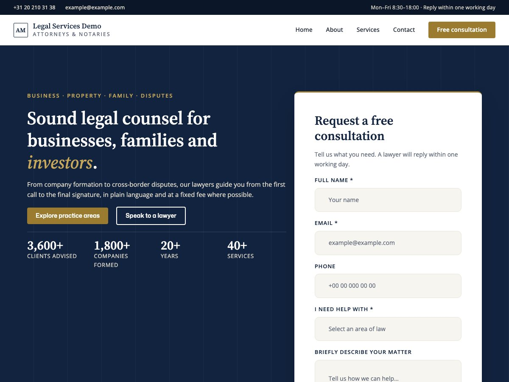

  <picture>
    <source media="(prefers-color-scheme: dark)" srcset="assets/logos/elayne-legal-gavel-dark.svg">
    
  </picture>

# Elayne Legal

**A complete law-firm website, built from blocks.** Elayne Legal is a child theme of [Elayne](https://github.com/imagewize/elayne) with a navy and gold design, serif headings and the sections a practice actually needs: from the enquiry form in the hero to the offices and the disclaimer in the footer.

No page builder, no build step, no stock photos to license. Insert a page pattern, edit the text in the Site Editor and publish.

## What's inside

| Section | What it does |
|---|---|
| Two-bar header | Utility bar with phone and email, then a sticky main bar with menu and call-to-action |
| Hero with enquiry form | Headline, key figures and a free-consultation card (Contact Form 7 when active, placeholder fields otherwise) |
| Services ticker | A scrolling strip of services, editable as a plain list |
| Practice areas | Tabs and a location filter; the small script loads only when the section is on the page |
| Departments, expertise band, offices | "What we do" cards, a navy feature band, and a map panel with office cards |
| Reviews, team, stats, contact | Social proof and detail sections in the same style |
| CTA strip and footer | Gold call-to-action band and a three-column footer with disclaimer bar |
| **Page patterns** | Home, About, Services and Contact, assembled from the sections above under a shared navy page header |

## Style variations

- **Legal Corporate** - navy and gold, Source Serif 4 headings, Open Sans body, compact type scale (fonts bundled, no external requests)
- **Legal Blue** - a professional navy blue and gold palette

Switch in **Appearance → Editor → Styles**.

## Install

Elayne must be installed first.

    composer require imagewize/elayne-legal

or upload the zip under **Appearance → Themes → Add New**, then activate **Elayne Legal** and pick a style. Add a page and insert one of the Legal page patterns.

Requires WordPress 7.0+, PHP 8.0+ and the Elayne parent theme.

## Notes

- Pattern slugs stay `elayne/legal-*`, so the patterns are drop-in replacements for the ones still bundled in the parent. The child's patterns win while both exist. Strings use the `elayne-legal` text domain.
- Images shared across verticals (avatars, icons) are loaded from the parent; legal-only images live in `patterns/images/legal/`.
- Photos are not bundled. Add your own, for example as the background of the expertise band or the team portraits.
- Development: `composer check` runs the Elayne pattern compliance checker; see `CLAUDE.md` for the sentinel editor validation.
- Prototypes for new designs live in the private `elayne-content` repo.

## License

GNU GPL v3 (or later). See `LICENSE.md`.

The gavel icon in `assets/logos/` is the [EOS Icons](https://eos-icons.com/) `gavel` icon by SUSE, obtained via [Blade Icons](https://blade-ui-kit.com/blade-icons/eos-gavel) and licensed under [MIT](https://opensource.org/licenses/MIT). It is recoloured (navy for light mode, white for dark mode).
